# DEVELOPMENT-ROADMAP.md: HasibShah News Theme

**Development Strategy:** Milestone-driven, incremental implementation with code reviews and technical mentoring at every step.  
**Theme Slug:** `hasibshah-news`  
**Target Environment:** WordPress 6.6+ / 7.x, PHP 8.1 - 8.4  
**Current Milestone:** Phase 0 (Planning & Architecture Review - Awaiting User Approval)  

---

## Roadmap Overview

```mermaid
flowchart LR
    P0["Phase 0: Architecture & Planning"] --> P1["Phase 1: Required Files & Scaffolding"]
    P1 --> P2["Phase 2: Design System & Fonts"]
    P2 --> P3["Phase 3: Header, Navigation & Ticker"]
    P3 --> P4["Phase 4: Editorial Homepage & Queries"]
    P4 --> P5["Phase 5: Single Article & Comments"]
    P5 --> P6["Phase 6: Archives, Search & 404"]
    P6 --> P7["Phase 7: Elementor & Gutenberg Integration"]
    P7 --> P8["Phase 8: Security & Performance Hardening"]
    P8 --> P9["Phase 9: Theme Check & WP.org Audit"]
```

---

## Detailed Milestone Breakdown

### Phase 0: Environment Setup, Architecture & Planning (CURRENT)
- [x] Inspect local WordPress environment (Studio v2.1.1, PHP 8.4.27, WP 7.1.4).
- [x] Check Git repository status.
- [x] Search for specification document (`HasibShah_News_Requirements.docx`).
- [x] Evaluate Classic vs. Block vs. Hybrid architecture.
- [x] Create and refine core planning documents (`ARCHITECTURE.md`, `DESIGN-SYSTEM.md`, `PROJECT-PLAN.md`, `DEVELOPMENT-ROADMAP.md`, `PROGRESS.md`).
- [x] Incorporate user review: remove premature query transients, define WP 6.6+ for `theme.json` v3, prefer native Elementor templates, define practical Elementor test suite, verify screenshot dimensions (1200x900 PNG), restrict `no_found_rows` to non-paginated queries, focus deduplication to Hero section.
- [ ] **Milestone Gate:** Obtain user approval to begin Phase 1 scaffolding.

---

### Phase 1: Theme Scaffolding & WordPress.org Required Files
- **Goal:** Establish a clean, standards-compliant theme directory containing all required files recognized by WordPress.
- **Tasks:**
  1. Initialize Git repository and commit baseline planning docs.
  2. Create `wp-content/themes/hasibshah-news/` directory.
  3. Create `style.css` with required WordPress theme headers (`Theme Name`, `Theme URI`, `Author`, `Requires at least: 6.6`, `Requires PHP: 8.1`, `License: GPL-2.0-or-later`, `Text Domain: hasibshah-news`).
  4. Create `index.php` as the primary required fallback template with semantic HTML5 loop.
  5. Create `comments.php` as the required accessible discussion template.
  6. Create `screenshot.png` placeholder meeting official WordPress.org requirements: **1200px wide by 900px high** (4:3 aspect ratio, PNG format, under 2MB).
  7. Create `readme.txt` conforming to WordPress.org standards (license headers, descriptions, changelog).
  8. Create `functions.php` with modular file loading architecture (`inc/core/`, `inc/editorial/`, `inc/compatibility/`, `inc/customizer/`).
  9. Create `theme.json` (v3) configured for fluid typography, color palettes, and editor layout limits (supported in WP 6.6+).
  10. Register core theme supports (`title-tag`, `post-thumbnails`, `html5`, `automatic-feed-links`, `responsive-embeds`).
  11. Register custom editorial image sizes (`hasibshah-news-lead`, `hasibshah-news-card`, `hasibshah-news-thumbnail`).
- **Acceptance Criteria:** Theme activates cleanly without PHP warnings or notices in WordPress 7.1.4 / PHP 8.4; all required WordPress.org files are present; WordPress Admin recognizes theme metadata accurately.

---

### Phase 2: Design System, Typography & Layout Engine
- **Goal:** Implement the CSS architecture, self-hosted Bangla/English fonts, and responsive layout grid.
- **Tasks:**
  1. Add local WOFF2 web fonts (Bangla & English) to `assets/fonts/` (zero external CDN requests).
  2. Implement `assets/css/base.css` with CSS custom properties, fluid typography clamp functions, and accessible resets.
  3. Implement Bangla headline overflow guards (word break, line height normalization 1.45 - 1.55, multiline clamping).
  4. Implement `assets/css/layout.css` for 12-column responsive newspaper grid, container constraints, and sidebar arrangements.
  5. Enqueue assets conditionally via `inc/core/assets.php`.
- **Acceptance Criteria:** Bangla text renders without diacritic clipping; responsive grid scales cleanly from mobile (360px) to ultra-wide desktop (1440px+).

---

### Phase 3: Header, Navigation & Breaking News Ticker
- **Goal:** Build an authentic, authoritative digital newspaper masthead.
- **Tasks:**
  1. Implement `header.php` with `wp_body_open()`, skiplinks, and semantic `<header>`.
  2. Create `template-parts/header/topbar.php` with dynamic Bangla date converter and edition switcher.
  3. Create `template-parts/header/masthead.php` supporting Custom Logo, site tagline, and responsive banner ad slot.
  4. Create accessible multi-level navigation menu with keyboard navigation script (`assets/js/navigation.js`).
  5. Build responsive mobile slide-out drawer menu with focus trapping.
  6. Create `template-parts/header/breaking-ticker.php` with accessible marquee / ticker loop and hover-pause controls.
- **Acceptance Criteria:** Full keyboard navigability (Tab/Enter/Esc); breaking ticker runs smoothly without layout shifts; header passes accessibility checks.

---

### Phase 4: Editorial Homepage & Dynamic News Queries
- **Goal:** Build the multi-section newspaper front page with efficient, lean query loops.
- **Tasks:**
  1. Create `front-page.php` with modular section loaders.
  2. Implement `template-parts/news-sections/section-hero.php`: 3-column split (Secondary Story + Lead Cover Story + Latest News Feed).
  3. Implement focused in-memory post deduplication strictly within the **Hero Section** (ensuring the primary Lead Story does not repeat in adjacent secondary slots), avoiding fragile multi-section global state.
  4. Implement `template-parts/news-sections/section-district.php`: Bangladesh regional news grid.
  5. Implement `template-parts/news-sections/section-grid.php`: 3/4 column category blocks (Politics, Business, Sports, Entertainment).
  6. Implement `template-parts/news-sections/section-media.php`: Dark-themed video & photo story cards.
  7. Implement `template-parts/news-sections/section-opinion.php`: Columnist cards with circular author portraits.
  8. Optimize non-paginated homepage queries by applying `'no_found_rows' => true` strictly where pagination totals are not needed. Keep the theme completely free from custom database/transient caching.
- **Acceptance Criteria:** Homepage renders cleanly; zero duplicate stories in the hero cover; zero custom query transient overhead.

---

### Phase 5: Single Article View, Related Stories & Comments
- **Goal:** Create an optimal reading experience for long-form Bangla journalism.
- **Tasks:**
  1. Create `single.php` and `template-parts/content/content-single.php`.
  2. Build article meta header: category pill, reporter byline, publish & update timestamps, reading time badge.
  3. Format featured image with caption and photographer credits.
  4. Design editorial body copy: drop-caps, pull quotes, lead paragraphs, and embedded media styling.
  5. Add lightweight, privacy-focused social sharing buttons (pure HTML/CSS, zero tracking cookies).
  6. Build author bio box with gravatar and social links.
  7. Implement related stories query based on shared tags or primary category (`'no_found_rows' => true`).
  8. Style `comments.php` with threaded replies, validation, and accessible form labels.
- **Acceptance Criteria:** High readability score; fully accessible comment form; proper schema markup via WordPress core.

---

### Phase 6: Archives, Category, District, Search & 404 Templates
- **Goal:** Complete the remaining standard WordPress template hierarchy with accessible pagination.
- **Tasks:**
  1. Create `archive.php` and `category.php` with customizable 2-column editorial layouts (main feed + sidebar).
  2. Implement accessible numbered pagination (`the_posts_pagination()`) using standard query row calculations (ensuring `no_found_rows` is **not** set so pagination totals calculate accurately).
  3. Create `author.php` for journalist profile pages with their published articles.
  4. Create `search.php` with clear search query display, result counts, and fallback suggestions.
  5. Create `404.php` featuring helpful links, search bar, and latest top stories.
  6. Implement `sidebar.php` with widgetized areas (Sidebar, Header Ad, Footer Columns).
- **Acceptance Criteria:** All standard WordPress routes render appropriate templates with consistent styling and accurate numbered pagination.

---

### Phase 7: Elementor & Gutenberg Integration
- **Goal:** Ensure seamless compatibility with page builders through clean containers and empirical testing.
- **Tasks:**
  1. Ensure standard `page.php` provides clean, unopinionated container wrappers allowing Elementor's native "Elementor Canvas" and "Elementor Full Width" templates to work automatically without duplicate custom theme templates.
  2. Add editor mode safety guards in `inc/compatibility/elementor.php` (`\Elementor\Plugin::$instance->editor->is_edit_mode()`) to prevent front-end ticker or drawer scripts from interfering with editor iframe initialization.
  3. Scope CSS resets to prevent collisions with Elementor Flexbox Containers, CSS Grid, and widget margins.
  4. **Execute Practical Elementor Test Suite:**
     - *Test A (Editor Frame):* Verify Elementor editor loads with zero console errors or iframe freezes.
     - *Test B (Widget Rendering):* Verify core Elementor widgets (Heading, Text, Image, Containers) render cleanly on test pages.
     - *Test C (Native Templates):* Verify Elementor Canvas and Full Width render properly without theme layout bleeding.
     - *Test D (Absence Test):* Deactivate Elementor and verify the theme runs 100% error-free.
  5. Register custom Gutenberg Block Patterns for news layouts (e.g. Breaking News Alert, Opinion Quote, 3-Card Story Grid).
  6. Add Gutenberg editor stylesheet (`assets/css/editor-style.css`) matching front-end typography.
- **Acceptance Criteria:** All 4 practical Elementor tests pass; Gutenberg editor reflects exact font and color choices.

---

### Phase 8: Performance, Accessibility & Security Hardening
- **Goal:** Optimize front-end speed, ensure WCAG compliance, and audit all security vectors.
- **Tasks:**
  1. Audit all dynamic outputs: enforce 100% escaping (`esc_html`, `esc_attr`, `esc_url`, `wp_kses_post`).
  2. Verify all inputs and URL query strings are sanitized (`sanitize_text_field`, `absint`).
  3. Verify nonces and capability checks across any theme AJAX actions.
  4. Audit CSS & JS payloads: ensure zero external HTTP calls to third-party CDNs.
  5. Add explicit `width` and `height` to all registered image sizes to prevent Cumulative Layout Shift (CLS).
  6. Add keyboard focus indicators (`:focus-visible`) for all interactive elements.
- **Acceptance Criteria:** Zero unescaped variables; Lighthouse Accessibility score 95+; zero render-blocking third-party scripts.

---

### Phase 9: Testing, Theme Check & WordPress.org Readiness Review
- **Goal:** Run comprehensive automated and manual audits against official Theme Review Guidelines.
- **Tasks:**
  1. Install and run `Theme Check` plugin via WP-CLI (`studio wp plugin install theme-check --activate`).
  2. Run Theme Check scan against `hasibshah-news`.
  3. Verify all function and hook prefixes strictly adhere to `hasibshah_news_`.
  4. Verify all mandatory files (`style.css`, `index.php`, `comments.php`, `screenshot.png` 1200x900, `readme.txt`) pass validation.
  5. Generate translation POT file in `languages/hasibshah-news.pot`.
  6. Review `readme.txt` metadata, GPL licenses, and copyright documentation.
  7. Final code review and mentorship retrospective.
- **Acceptance Criteria:** Zero Theme Check errors or critical warnings; 100% ready for manual WordPress.org submission review.
